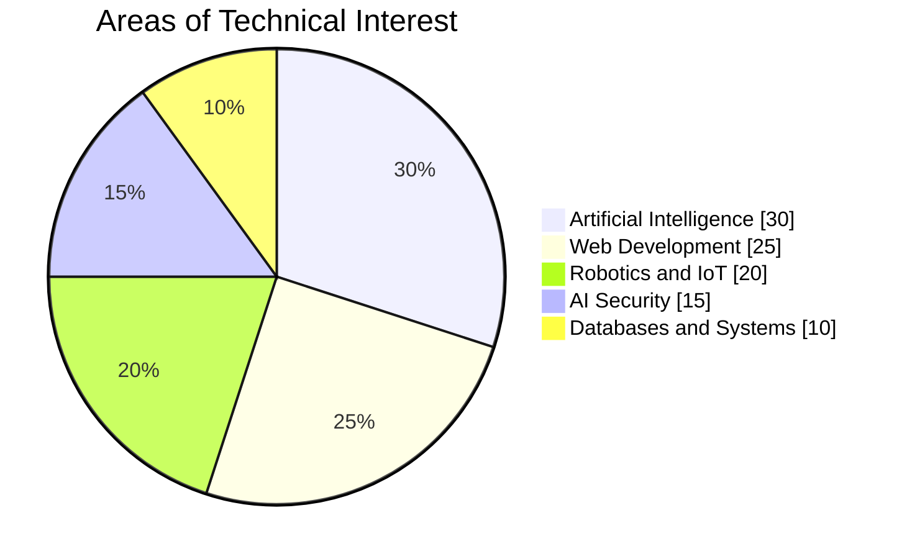

# Hi, I'm M KIRAN 👋

I am a passionate developer focused on logic building, algorithm optimization, and hardware integration. 

# 👋 Hey, I'm M Kiran

### 💻 Developer · 🤖 AI Builder · 🚀 Technology Enthusiast

<p align="center">
  
</p>

<p align="center">
  
  
  
</p>

---

## 🌌 About Me

I'm a **BCA student, developer, and independent project builder** passionate about using technology to solve real-world problems.

I enjoy experimenting with AI, creating web applications, exploring robotics, and turning ideas into functional prototypes. From intelligent civic platforms to adversarial AI security and smart traffic management, I'm interested in building technology that goes beyond a simple demo.

- 🎓 Pursuing a Bachelor of Computer Applications (BCA).
- 🧠 Exploring Artificial Intelligence and agentic systems.
- 🌐 Building modern web applications and interactive experiences.
- 🛡️ Interested in AI security and adversarial machine learning.
- 🤖 Experimenting with robotics, IoT, and automation.
- 🏆 Developing projects for hackathons and independent innovation.
- 📚 Constantly learning, testing, debugging, and improving.

> *Think creatively. Build intelligently. Make technology matter.*

## 🛠️ Technology Universe

<p align="center">
  
</p>

<p align="center">
  
</p>

<p align="center">
  
  
  
  
  
</p>

## 📊 My Areas of Interest

The chart below represents my broad technical interests, not measured proficiency or time spent.



## 🚀 Featured Projects

<table>
<tr>
<td width="50%" valign="top">

### 🏙️ CivicAI

**AI-Powered Smart Citizen Platform**

A civic technology platform designed to help citizens report public issues and route complaints toward the appropriate municipal departments.

- AI-assisted complaint classification
- Issue urgency and department recommendations
- Citizen-focused complaint tracking

`AI` `CivicTech` `Supabase`

</td>
<td width="50%" valign="top">

### 🚦 TrafficFlow AI

**Smart Traffic Management**

An intelligent traffic management concept exploring traffic signal simulation, adaptive timing, and emergency vehicle priority.

- Traffic intersection simulation
- Configurable signal timing
- Smart-city optimization concepts

`AI` `Smart Cities` `Simulation`

</td>
</tr>
<tr>
<td width="50%" valign="top">

### 🛡️ AEGIS AI

**Adversarial ML Defense Tools**

A security-focused project for exploring adversarial inputs and testing the robustness of AI systems.

- Prompt security testing
- Adversarial testing workflows
- Defense concepts and reports

`AI Security` `ML` `Cybersecurity`

</td>
<td width="50%" valign="top">

### 🕸️ NEXUS

**Graph-Powered AI Exploration**

A project exploring graph databases and intelligent knowledge workflows, associated with my graph technology hackathon work.

- Graph-based knowledge modeling
- AI and knowledge exploration
- Intelligent workflow concepts

`FalkorDB` `Graph Databases` `AI`

</td>
</tr>
<tr>
<td width="50%" valign="top">

### 🧠 SBI EngageAI

**Digital Engagement**

An AI-oriented project developed around the theme of agentic AI and emerging technologies.

`Agentic AI` `Digital Experiences`

</td>
<td width="50%" valign="top">

### 🤖 Robotics Lab

**Robotics and Automation Experiments**

Exploring Wi-Fi-controlled robots, obstacle avoidance, embedded systems, and intelligent automation.

`Arduino` `ESP32` `IoT`

</td>
</tr>
</table>

## 📈 GitHub Dashboard

<p align="center">
  
  
</p>

<p align="center">
  
</p>

*These dashboard cards retrieve information from GitHub and third-party services. Their availability and displayed metrics depend on the services and your public GitHub activity.*

## 🧭 What I'm Exploring Next

```text
Artificial Intelligence  ━━━━━━━━━━  Learning & Building
Full-Stack Development   ━━━━━━━━━━  Creating Applications
AI Security              ━━━━━━━━━━  Testing & Defending
Robotics and IoT         ━━━━━━━━━━  Experimenting
System Design             ━━━━━━━━━━  Improving Architecture
```

These bars represent areas I'm exploring, not verified skill ratings.

## 💡 My Development Philosophy

- **Build real things:** prioritize useful functionality over appearance alone.
- **Keep learning:** treat every bug and experiment as an opportunity.
- **Design thoughtfully:** build interfaces that are accessible and easy to use.
- **Test properly:** aim for reliable behavior, security, and maintainable code.
- **Stay curious:** explore emerging technologies and question how things work.

## 🌐 Connect With Me

<p align="center">
  <a href="https://github.com/YOUR_USERNAME">
    
  </a>
  <a href="https://www.linkedin.com/">
    
  </a>
</p>

<p align="center">
  <i>Building today. Learning every day. Creating for tomorrow.</i>
</p>

<p align="center">
  
</p>
